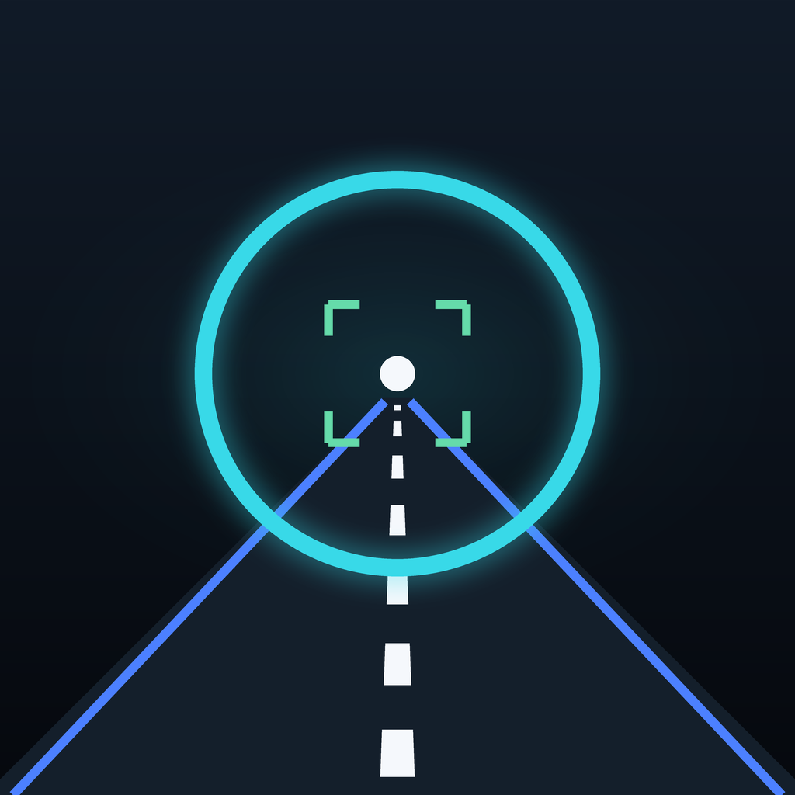
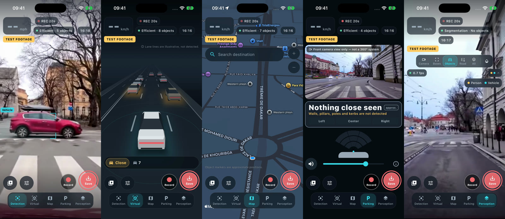
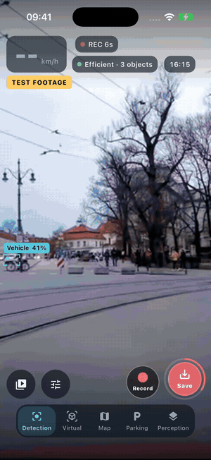

<div align="center">



# Corvista

**On-device AI dashcam and road-awareness companion for iPhone.**

Real-time object detection, a 2.5D virtual road view, 3D maps with turn-by-turn,
parking proximity, a rolling-buffer dashcam and a trip log. Everything runs on the phone.

[](#requirements)
[](https://flutter.dev)
[](packages/corvista_native)
[](#testing)
[](lib/l10n)
[](LICENSE)

[**▶ Watch the demo (6 min)**](https://github.com/fahdxemcpu/corvista/releases/download/v1.0.0-preview/corvista_demo.mp4) ·
[Features](#features) · [Architecture](#architecture) · [Build](#getting-started) · [License](#license)



</div>

---

## Demo

<table>
<tr>
<td width="300"></td>
<td>

The demo is a full automated QA run on the iOS Simulator. The app is fed real road
footage and runs **real on-device inference** on every frame: there are no mocked detections.

It covers onboarding, permissions, the guided tour, all five views, saving an
incident clip, the clips library, trips, settings, the emergency countdown,
light theme and Arabic (RTL), German and Japanese.

**[Download the full demo video (MP4, 23 MB)](https://github.com/fahdxemcpu/corvista/releases/download/v1.0.0-preview/corvista_demo.mp4)**

<sub>Footage: “City Driving 4K – Kraków Poland 2024” by Relaxing Roads 4K, Wikimedia Commons, CC BY 3.0.</sub>

</td>
</tr>
</table>

## Features

| | |
|---|---|
| 🎯 **Detection** | 7 road classes (person, bicycle, motorcycle, vehicle, bus, traffic light, stop sign) with Core ML on the Neural Engine, ByteTrack-style tracking, and distance zones from a self-calibrating ground plane |
| 🚗 **Virtual 2.5D** | A simplified road scene built from real tracks. Objects are placed where they touch the road and snapped to lanes. Supports left- and right-hand traffic, with 3 styles |
| 🗺️ **Maps & turn-by-turn** | MapKit 3D, search, alternate routes, geometry-based maneuvers, route-matched position with dead reckoning, speed-scaled voice prompts, rerouting and ETA. Keeps guiding in the background, with a Live Activity and Dynamic Island |
| 🅿️ **Parking** | Close-range proximity zones (Stop / Very close / Close), left/centre/right bar and beeps. It says honestly what it cannot see |
| 🧠 **Perception** | Semantic segmentation with object masks and a road-surface overlay |
| 🎥 **Dashcam** | One shared capture session, a 20–30 s rolling buffer of 2 s segments, Save Incident, manual recording in 5-minute parts with crash recovery, 720p/1080p, optional audio, and watermark plus timestamp burn-in |
| 📚 **Recordings** | Library with filters, trim, Save to Photos, share, rename, favourites and storage management |
| 🧭 **Trip log** | Automatic trips with GPS track, stats, detections and an event timeline linked to clips. GPX export |
| 🔊 **Alerts** | Spoken alerts for nearby objects, traffic-light changes and "traffic moving ahead", with cooldowns |
| 🆘 **Emergency mode** | Opt-in detection of a possible crash, with a countdown and voice cancel. It prepares a call or SMS to your chosen contacts, and iOS always asks you to confirm |
| 🌍 **Worldwide** | 43 locales, Arabic RTL, regional units and emergency numbers, left-hand-traffic roundabouts |
| 🔒 **Private** | No account, no analytics and no cloud. Frames never leave the device |

## Architecture

```
Flutter (Dart) ─ UI, Riverpod 3 state, pure tested logic (tracker, estimator,
                 alert engine, guidance, impact detector), Drift/SQLite
        │  MethodChannel corvista/engine · EventChannels · Texture · PlatformView
corvista_native (Swift, iOS 17)
   AVCaptureSession ─┬─► Flutter texture (preview)
                     ├─► Vision / Core ML (detection + segmentation)
                     └─► AVAssetWriter rolling buffer → incident / manual clips
   MapKit · CoreLocation · CoreMotion · AVSpeech · ActivityKit · WeatherKit
```

Frames never cross into Dart. One capture pipeline feeds the preview, inference and
recording. More detail is in [docs/ARCHITECTURE.md](docs/ARCHITECTURE.md),
[docs/BRIDGE.md](docs/BRIDGE.md), [docs/ESTIMATION.md](docs/ESTIMATION.md) and
[docs/MODELS.md](docs/MODELS.md).

```
lib/app        app, router, bootstrap, providers
lib/core       theme, widgets, permissions, errors
lib/domain     models, repositories, services
lib/data       Drift database
lib/features   detection · virtual_view · maps · navigation · parking ·
               segmentation · clips · trips · emergency · settings · tour …
packages/corvista_native   Swift engine (camera, inference, recording, maps…)
ios/CorvistaLiveActivity   Live Activity / Dynamic Island extension
```

## Getting started

### Requirements
- macOS with Xcode 26+, and an iPhone or Simulator on iOS 17+
- Flutter 3.47 / Dart 3.13

### Build & run
```bash
flutter pub get
dart run build_runner build --delete-conflicting-outputs
flutter gen-l10n
flutter run            # on a connected iPhone (set your signing team in Xcode)
```

The Simulator has no camera. To test with recorded footage, use
**Settings › Diagnostics › Test footage** (any local `.mp4`). Real inference runs on it.
WeatherKit needs an App ID with the WeatherKit capability.

## Testing

```bash
flutter test test                                   # 401 unit & widget tests
dart analyze lib test integration_test
tools/qa/run_tour.sh <sim-udid> <out-dir> <video>   # full QA tour + screenshots
tools/qa/run_drive.sh                                # real-road drive scenarios
```

Test fixtures cover drive and parking detection sequences, segmentation maps,
routes and crash/non-crash motion profiles.

## Status

All features are built, analysis is clean, and the full QA tour passes on the Simulator.
**Not yet validated on a physical iPhone** (camera alignment, recording, thermal
behaviour and Neural Engine speed). See [docs/PROGRESS.md](docs/PROGRESS.md) and
[docs/FEATURE_PARITY.md](docs/FEATURE_PARITY.md).

> ⚠️ **Safety.** Corvista is a driving aid, not a safety system. Detection can miss,
> misclassify or misplace objects, especially at night, in rain or with a dirty windshield.
> Distances are approximate zones. Keep your eyes on the road.

## License

**Source-available, not OSI open source.** See [LICENSE](LICENSE).

- ✅ **Free for non-commercial use**: personal use, study, research, teaching
  and non-profit use. You may modify and share it under the same licence, with credit.
- 💼 **Commercial use requires a commercial licence** with a royalty of
  **10% of gross revenue**. This includes selling the app or a derivative, publishing it
  with ads, in-app purchases or subscriptions, or using it in a paid service.
  [Request a commercial licence](https://github.com/fahdxemcpu/corvista/issues/new?template=commercial_license.md).
- The "Corvista" name and icon are not licensed for derivatives.

Third-party components (YOLOX and DETR models, Apache-2.0; Flutter packages) keep
their own licences. See [NOTICE](NOTICE).

<div align="center"><sub>© 2026 Fahd Chouki</sub></div>
